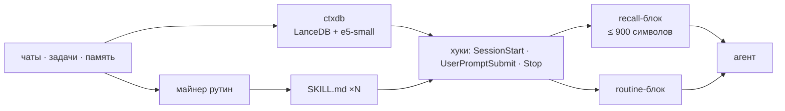
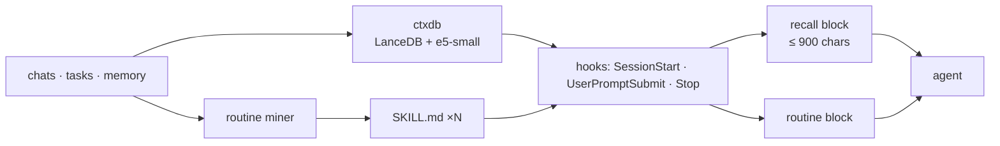

# ZCode · Плагины и расширения

<p align="center">
  
</p>

<p align="center">
  
  
  
  
  
  
  
</p>

**RU** · [English](#english)

---

## О репозитории

Репозиторий плагинов и расширений для **ZCode Desktop**. Каждый пакет автономен:
свой манифест, команды, скиллы и документация. Репозиторий одновременно служит
маркетплейсом — `marketplace.json` в корне.

## Каталог

| Пакет | Что делает | Команда | Полная страница |
|---|---|---|---|
| [`zcode-ru`](plugins/zcode-ru) | полный русский интерфейс ZCode, 6999 строк, установка / проверка / откат | `/rusifikator` | [docs/ru/zcode-ru.md](docs/ru/zcode-ru.md) |
| [`routine-miner`](plugins/routine-miner) | находит повторяющиеся действия и пакует их в скилы; подставляет скилл под типовой запрос автоматически | `/routine-miner` | [docs/ru/routine-miner.md](docs/ru/routine-miner.md) |
| [`ctxdb-setup`](plugins/ctxdb-setup) | локальная векторная память (LanceDB + e5): индекс всех чатов, задач и памяти по всем проектам, автоподстановка контекста, перенос установки одной папкой | `/ctxdb` | [docs/ru/ctxdb-setup.md](docs/ru/ctxdb-setup.md) |
| [`zcode-counters`](plugins/zcode-counters) | полоса счётчиков токенов над полем ввода: ходы · шаги · ток/с · Σ · попадание в кэш | `/zcode-counters` | [docs/ru/zcode-counters.md](docs/ru/zcode-counters.md) |

**zcode-ru** переводит каталог строк, нативное меню, диалоги обновления и шаблоны
автоматизаций. Перевод не поставляется готовым архивом: `patch.js` пересобирает его
из установленной версии ZCode, поэтому обновление приложения не ломает установку —
её нужно просто повторить. Ключи остаются английскими, меняются только значения.
Подробности — на странице пакета.

## Инструменты

Не плагины, а обслуживание установки:

| Инструмент | Что делает |
|---|---|
| [`tools/install-zcode-ui-task.ps1`](tools/install-zcode-ui-task.ps1) | регистрирует задачу Windows: после каждого обновления ZCode сама возвращает русификатор и счётчики, без UAC |
| [`tools/restore-zcode-ui.ps1`](tools/restore-zcode-ui.ps1) | сборка и установка объединённого архива вручную: `-BuildOnly`, `-Force`, `-Auto` |

```powershell
powershell -NoProfile -ExecutionPolicy Bypass -File tools\install-zcode-ui-task.ps1
```

Задача `ZCodeUiRestore` срабатывает при входе и каждые 15 минут; демон ctxdb
дополнительно следит за `app.asar` и запускает её сразу после обновления.
Патчи применяются к следующему запуску ZCode. Подробности — [`tools/README.md`](tools/README.md).

## Экосистема



- **ctxdb** индексирует историю один раз и подмешивает релевантные фрагменты в каждый
  промпт. Поиск локальный — 0 токенов; в промпт уходит не больше 900 символов.
- **routine-miner** смотрит на повторяющиеся запросы и превращает их в скилы. Хук
  подставляет блок `<routine>` с путём к скиллу вместо повторного разбора.
- **zcode-ru** не участвует в этой цепочке: он про интерфейс, а не про контекст.

## Как установить

```bash
git clone https://github.com/rukazax/z-code
```

В ZCode: **Плагины → Добавить → Добавить плагин-маркетплейс**, указать папку `z-code`
(в ней лежит `marketplace.json`). Дальше **Личное → rukazax-z-code → нужный плагин →
Установить**. Установленные плагины живут в **Настройки → Плагины**.

Из чата:

```
/rusifikator          — русский интерфейс: установить или проверить
/routine-miner скан   — найти повторяющиеся задачи и собрать скилы
/ctxdb                — статус векторной памяти: doctor + stats
```

`routine-miner` и `ctxdb-setup` требуют локальный каталог `ctxdb` с кодом и
установленными зависимостями — пошаговый плейбук в
[`docs/ru/ctxdb-setup.md`](docs/ru/ctxdb-setup.md).

## Безопасность

- Секреты, токены и история остаются локально. Сеть нужна только для установки
  (`git clone`, `npm install`, `winget`) и разовой загрузки весов
  `multilingual-e5-small` (~129 МБ).
- `routine-miner` и `ctxdb-setup` не требуют UAC: они работают в пользовательском
  профиле. Права администратора нужны только `zcode-ru` — он пишет `app.asar` в
  `C:\Program Files\ZCode`.
- Хуки ctxdb прописываются в `%USERPROFILE%\.zcode\cli\config.json`; перед правкой
  создаётся `config.json.ctxdb-backup`, снять хуки — `uninstall-hooks`.
- Снимок `ctxdb backup` по умолчанию **включает секреты** (`credentials.json`, токен
  `gh`). Для обмена используй `--no-credentials` и шифруй архив.
- Плагины не трогают настройки, сессии и историю ZCode сверх заявленного: `zcode-ru`
  меняет строки интерфейса, ctxdb только читает базы и пишет свой индекс.

## Правила

1. Новые плагины и расширения ZCode публикуются в этот репозиторий **автоматически**,
   без отдельного запроса и подтверждения: `plugins/<name>`.
2. Каждый пакет автономен: свои манифест, скрипты и документация; зависимостей хоста
   по минимуму.
3. Документация двуязычная (RU/EN) в стиле GitHub: заголовки, таблицы, схемы, примеры
   команд.
4. Скрипты проверяются перед публикацией: `node --check` для JS, разбор для PowerShell.
5. Секреты, токены и персональные данные в репозиторий не попадают.

## Ограничения

- Windows 10/11: пути установки ZCode и хуки рассчитаны на Windows.
- `zcode-ru` собран под ZCode 3.16.3; после обновления приложения перевод ставится
  заново.
- `routine-miner` и `ctxdb-setup` — обвязка над локальным ctxdb: без каталога `ctxdb`
  и проиндексированной истории они ничего не покажут.
- Мало истории — мало рутин: кластеру нужно минимум два похожих запроса.

## Документация

- [zcode-ru: перевод интерфейса](docs/ru/zcode-ru.md) · [zcode-ru (EN)](docs/en/zcode-ru.md)
- [routine-miner: скилы из рутин](docs/ru/routine-miner.md) · [routine-miner (EN)](docs/en/routine-miner.md)
- [ctxdb-setup: векторная память](docs/ru/ctxdb-setup.md) · [ctxdb-setup (EN)](docs/en/ctxdb-setup.md)
- [Правила разработки и публикации](CONTRIBUTING.md) · [Глобальное правило](AGENTS.md)
- [История изменений](CHANGELOG.md)

## Лицензия

[MIT](LICENSE) © 2026 rukazax

---

## English

Repository of **ZCode Desktop** plugins and extensions. Every package is
self-contained: its own manifest, commands, skills and documentation. The repository
also works as a marketplace — `marketplace.json` lives at the root.

| Package | Purpose | Command | Full page |
|---|---|---|---|
| [`zcode-ru`](plugins/zcode-ru) | a complete Russian UI for ZCode, 6999 strings, install / check / rollback | `/rusifikator` | [docs/en/zcode-ru.md](docs/en/zcode-ru.md) |
| [`routine-miner`](plugins/routine-miner) | finds repeated actions and packs them into skills; injects the skill for a typical request automatically | `/routine-miner` | [docs/en/routine-miner.md](docs/en/routine-miner.md) |
| [`ctxdb-setup`](plugins/ctxdb-setup) | local vector memory (LanceDB + e5): every chat, task and memory indexed across projects, automatic context injection, one-folder migration | `/ctxdb` | [docs/en/ctxdb-setup.md](docs/en/ctxdb-setup.md) |
| [`zcode-counters`](plugins/zcode-counters) | a token-counter strip above the input field: turns · steps · tok/s · Σ · cache hit | `/zcode-counters` | [docs/en/zcode-counters.md](docs/en/zcode-counters.md) |

**zcode-ru** translates the string catalog, the native menu, update dialogs and
automation templates. It does not ship a ready-made archive: `patch.js` rebuilds the
translation from the installed ZCode version, so an app update does not break the
setup — it just has to be applied again. Keys stay English; only values change.

### Tools

Not plugins — installation maintenance:

| Tool | Purpose |
|---|---|
| [`tools/install-zcode-ui-task.ps1`](tools/install-zcode-ui-task.ps1) | registers a Windows task that restores the Russian UI and counters after every ZCode update, without UAC |
| [`tools/restore-zcode-ui.ps1`](tools/restore-zcode-ui.ps1) | manual build & install of the combined archive: `-BuildOnly`, `-Force`, `-Auto` |

```powershell
powershell -NoProfile -ExecutionPolicy Bypass -File tools\install-zcode-ui-task.ps1
```

The `ZCodeUiRestore` task runs at logon and every 15 minutes; the ctxdb daemon also
watches `app.asar` and triggers it right after an update. Patches apply on the next
ZCode launch. Details — [`tools/README.md`](tools/README.md).

### Ecosystem



- **ctxdb** indexes history once and injects relevant fragments into every prompt.
  Search is local — 0 tokens; at most 900 characters enter the prompt.
- **routine-miner** watches repeated prompts and turns them into skills. The hook
  injects a `<routine>` block with the skill path instead of re-deriving the pattern.
- **zcode-ru** stays out of this chain: it is about the interface, not context.

### Install

```bash
git clone https://github.com/rukazax/z-code
```

In ZCode: **Plugins → Add → Add plugin marketplace**, point it at the `z-code`
folder (it contains `marketplace.json`). Then **Personal → rukazax-z-code → the
plugin → Install**. Installed plugins are managed under **Settings → Plugins**.

From the chat:

```
/rusifikator          — Russian UI: install or check
/routine-miner scan   — find repeated tasks and build skills
/ctxdb                — vector memory status: doctor + stats
```

`routine-miner` and `ctxdb-setup` need a local `ctxdb` directory with code and
installed dependencies — the step-by-step playbook is in
[`docs/en/ctxdb-setup.md`](docs/en/ctxdb-setup.md).

### Security

- Secrets, tokens and history stay local. The network is used only for installation
  (`git clone`, `npm install`, `winget`) and the one-time download of the
  `multilingual-e5-small` weights (~129 MB).
- `routine-miner` and `ctxdb-setup` need no UAC: they work inside the user profile.
  Administrator rights are only required by `zcode-ru`, which writes `app.asar` in
  `C:\Program Files\ZCode`.
- ctxdb hooks are registered in `%USERPROFILE%\.zcode\cli\config.json`; the file is
  backed up as `config.json.ctxdb-backup`, and `uninstall-hooks` removes them.
- A `ctxdb backup` snapshot **contains secrets by default** (`credentials.json`, the
  `gh` token). Use `--no-credentials` for sharing and encrypt the archive.
- Plugins do not touch ZCode settings, sessions or history beyond what is declared:
  `zcode-ru` replaces UI strings, ctxdb only reads databases and writes its own index.

### Rules

1. New ZCode plugins and extensions are published to this repository
   **automatically**, without a separate request or confirmation: `plugins/<name>`.
2. Every package is self-contained: its own manifest, scripts and documentation;
   minimal host coupling.
3. Documentation is bilingual (RU/EN) in GitHub style: headings, tables, diagrams,
   command examples.
4. Scripts are verified before publishing: `node --check` for JS and a parser pass for
   PowerShell.
5. Secrets, tokens and personal data never enter the repository.

### Limitations

- Windows 10/11: install paths and hooks target Windows.
- `zcode-ru` is built against ZCode 3.16.3; after an app update the translation has to
  be applied again.
- `routine-miner` and `ctxdb-setup` are wrappers around a local ctxdb: without the
  `ctxdb` directory and indexed history they show nothing.
- Little history means few routines: a cluster needs at least two similar prompts.

### Documentation

- [zcode-ru: interface translation](docs/en/zcode-ru.md) · [zcode-ru (RU)](docs/ru/zcode-ru.md)
- [routine-miner: skills from routines](docs/en/routine-miner.md) · [routine-miner (RU)](docs/ru/routine-miner.md)
- [ctxdb-setup: vector memory](docs/en/ctxdb-setup.md) · [ctxdb-setup (RU)](docs/ru/ctxdb-setup.md)
- [Contributing rules](CONTRIBUTING.md) · [Global publishing rule](AGENTS.md)
- [Changelog](CHANGELOG.md)

### License

[MIT](LICENSE) © 2026 rukazax
