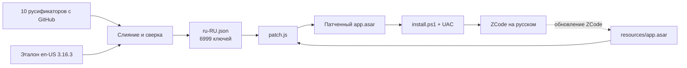
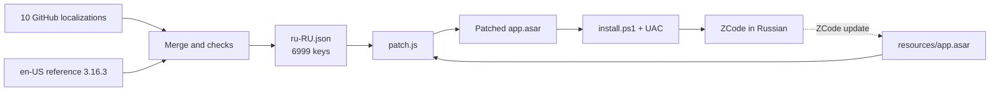

# ZCode · Русская локализация

<p align="center">
  
</p>

<p align="center">
  
  
  
  
</p>

**RU** · [English](#english)

---

## О проекте

Репозиторий плагинов и расширений для **ZCode Desktop**. Первый пакет — [`zcode-ru`](plugins/zcode-ru):
полный русский интерфейс приложения — каталог строк, меню, диалоги обновления, шаблоны автоматизаций.

Пакет решает прикладную задачу: ZCode поставляется только с китайским и английским интерфейсом, а
готовые русификаторы покрывают его частично и расходятся между собой. Перевод здесь собран из всех
публичных русификаторов сразу, сверен с эталонным каталогом установленной версии и доведён до
100% ключей — без ручных правок после установки.

Отдельная проблема, которую пакет закрывает: каждое обновление ZCode возвращает оригинальный
`app.asar`. Поэтому перевод не поставляется готовым архивом, а собирается заново из той версии,
которая установлена сейчас.

## Состав

| Пакет | Назначение | Стек |
|---|---|---|
| [`zcode-ru`](plugins/zcode-ru) | Русский интерфейс ZCode: 6999 строк каталога, меню, диалоги, шаблоны автоматизаций; установка, проверка, откат | PowerShell 5.1 + Node.js (через рантайм ZCode) |

## Архитектура

<p align="center">
  
</p>



Устройство перевода: ZCode знает ровно две локали — `zh-CN` и `en-US`, тип локали закрыт в коде.
Поэтому новый язык не добавляется: плагин перезаписывает значения английского каталога русскими,
сохраняя ключи. Меняются четыре файла бандла:

| Файл в `app.asar` | Что переводится |
|---|---|
| `out/renderer/assets/IntlProvider-*.js` | каталог интерфейса, 6999 ключей |
| `out/main/chunk-*.js` | нативное меню приложения |
| `out/main/index.js` | диалоги обновления и «О программе» |
| `out/renderer/assets/styles-*.js` | шаблоны автоматизаций и известные серверные попапы |

SHA-256 всех изменённых файлов в заголовке архива пересчитывается — иначе Electron откажется их
читать. Неизменённые файлы остаются на своих смещениях, поэтому запущенный ZCode продолжает
работать до перезапуска.

## Быстрый старт

### 1. Установка из репозитория

```bash
git clone https://github.com/rukazax/z-code
```

В ZCode: **Плагины → Добавить → Добавить плагин-маркетплейс**, указать папку `z-code` (в ней лежит
`marketplace.json`). После добавления — **Личное → dev-zcode-ru-localization → ZCode на русском →
Установить**. Дальше плагин живёт в **Настройки → Плагины**.

Из чата:

```
/rusifikator          — установить или обновить
/rusifikator статус   — только проверить
/rusifikator откат    — вернуть оригинальный интерфейс
```

### 2. Без плагина, напрямую

```powershell
powershell -NoProfile -ExecutionPolicy Bypass -File plugins\zcode-ru\assets\apply.ps1
```

Скрипт собирает архив из текущей установки, запрашивает UAC, сохраняет оригинал в
`%LOCALAPPDATA%\ZCodeRu\app.asar.backup` и ставит перевод. После установки ZCode нужно закрыть
полностью (трей → «Выйти») и открыть заново.

### 3. Проверка и откат

```powershell
powershell -NoProfile -ExecutionPolicy Bypass -File plugins\zcode-ru\assets\check.ps1
powershell -NoProfile -ExecutionPolicy Bypass -File plugins\zcode-ru\assets\uninstall.ps1
```

`check.ps1` только читает: путь установки, версия приложения, наличие бэкапа, русский ли интерфейс.

## Схемы и документация

- [zcode-ru: перевод интерфейса](docs/ru/zcode-ru.md) · [zcode-ru (EN)](docs/en/zcode-ru.md)
- [Правила разработки и публикации](CONTRIBUTING.md) — двуязычные
- [Глобальное правило публикации](AGENTS.md) · [Global rule (EN)](AGENTS.md#english)
- [История изменений](CHANGELOG.md)

## Правила

1. Новые плагины и расширения ZCode публикуются в этот репозиторий **автоматически**, без отдельного
   запроса и подтверждения: `plugins/<name>`.
2. Каждый пакет автономен: свои манифест, скрипты и документация; зависимостей хоста по минимуму.
3. Документация двуязычная (RU/EN) в стиле GitHub: заголовки, таблицы, схемы, примеры команд.
4. Скрипты проверяются перед публикацией: `node --check` для JS, разбор для PowerShell.
5. Секреты, токены и персональные данные в репозиторий не попадают.

## Безопасность

- Плагин не содержит секретов и ничего не отправляет в сеть: сборка и установка идут локально.
- Запись в `C:\Program Files\ZCode` требует прав администратора; `install.ps1` вызывает UAC и не
  работает без подтверждения.
- Перед установкой сохраняется оригинальный `app.asar`; откат ставит его обратно.
- Скрипты не трогают пользовательские настройки, сессии, историю и профиль ZCode.
- Перевод лишь заменяет строки интерфейса. Логика приложения, ключи каталога и проверка целостности
  архива остаются штатными.

## Ограничения

- Windows: пути установки `C:\Program Files\ZCode` и `%LOCALAPPDATA%\Programs\ZCode`.
- Обновление ZCode возвращает оригинальный интерфейс — установку нужно повторить.
- Строки, которые приходят с API (акционные попапы, часть текстов шаблонов), переводятся только
  для известного набора; новые формулировки останутся английскими до обновления плагина.
- Если структура бандла в новой версии изменится, `patch.js` завершится ошибкой с понятным
  сообщением, ничего не записав.

## Лицензия

[MIT](LICENSE) © 2026 rukazax

---

## English

Repository of **ZCode Desktop** plugins and extensions. The first package is [`zcode-ru`](plugins/zcode-ru):
a complete Russian UI — the string catalog, the native menu, update dialogs and automation templates.

The package addresses a concrete problem: ZCode ships with Chinese and English only, while community
localizations cover the interface partially and disagree with each other. The translation here is
assembled from every public localization at once, checked against the reference catalog of the
installed version and brought to 100% of the keys — no manual fixes after installation.

One more issue it handles: every ZCode update restores the stock `app.asar`. So the localization is not
shipped as a ready-made archive; it is rebuilt from whatever version is installed right now.

| Package | Purpose | Stack |
|---|---|---|
| [`zcode-ru`](plugins/zcode-ru) | Russian UI for ZCode: 6999 catalog strings, menu, dialogs, automation templates; install, check, rollback | PowerShell 5.1 + Node.js (through the ZCode runtime) |

<p align="center">
  
</p>



How it works: ZCode knows exactly two locales, `zh-CN` and `en-US`, and the locale type is closed in
code. So the plugin does not add a language — it rewrites the values of the English catalog in Russian
while keeping the keys. Four bundle files change: the renderer catalog, the native menu, the update
dialogs and the automation templates. SHA-256 hashes of the changed files in the archive header are
recalculated, otherwise Electron refuses to read them.

### Quick start

```bash
git clone https://github.com/rukazax/z-code
```

In ZCode: **Plugins → Add → Add plugin marketplace**, point it at the `z-code` folder (it contains
`marketplace.json`). Then **Personal → dev-zcode-ru-localization → ZCode in Russian → Install**. After
that the plugin is managed under **Settings → Plugins**.

Without the plugin:

```powershell
powershell -NoProfile -ExecutionPolicy Bypass -File plugins\zcode-ru\assets\apply.ps1
powershell -NoProfile -ExecutionPolicy Bypass -File plugins\zcode-ru\assets\check.ps1
powershell -NoProfile -ExecutionPolicy Bypass -File plugins\zcode-ru\assets\uninstall.ps1
```

The installer requests elevation, keeps the original archive in
`%LOCALAPPDATA%\ZCodeRu\app.asar.backup` and writes the translation. ZCode has to be closed completely
(tray → Quit) and started again afterwards.

### Rules

1. New ZCode plugins and extensions are published to this repository **automatically**, without a
   separate request or confirmation: `plugins/<name>`.
2. Every package is self-contained: its own manifest, scripts and documentation; minimal host coupling.
3. Documentation is bilingual (RU/EN) in GitHub style: headings, tables, diagrams, command examples.
4. Scripts are verified before publishing: `node --check` for JS and a parser pass for PowerShell.
5. Secrets, tokens and personal data never enter the repository.

### Security

- The plugin carries no secrets and sends nothing over the network: build and install are local.
- Writing to `C:\Program Files\ZCode` requires administrator rights; `install.ps1` raises UAC and does
  nothing without confirmation.
- The original `app.asar` is backed up before installation; the rollback script restores it.
- The scripts do not touch ZCode settings, sessions, history or the user profile.
- Only UI strings are replaced. Application logic, catalog keys and archive integrity checks stay stock.

### Limitations

- Windows only: install paths `C:\Program Files\ZCode` and `%LOCALAPPDATA%\Programs\ZCode`.
- A ZCode update restores the English interface; the localization has to be applied again.
- Strings coming from the API (campaign popups, part of template texts) are translated only for a known
  set; new wording stays English until the plugin is updated.
- If the bundle layout changes in a future version, `patch.js` fails with a clear message and writes
  nothing.

### License

[MIT](LICENSE) © 2026 rukazax
