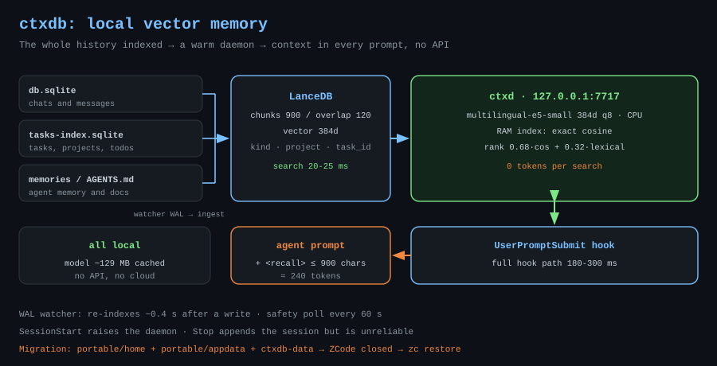
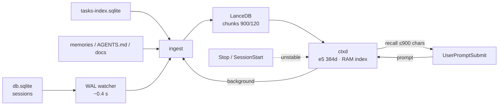

# ctxdb-setup — local vector memory for ZCode

<p align="center">
  
</p>

[Русский](../ru/ctxdb-setup.md) · **EN**

Package page: [`plugins/ctxdb-setup`](../../plugins/ctxdb-setup) · Repository overview: [`README.md`](../../README.md)

## What it is

A single index over all chats, tasks, agent memories and documents across every
project. Relevant context is injected into each prompt automatically, with clear
separation by project and task. Everything runs locally: LanceDB plus
`multilingual-e5-small`; at runtime only the one-time model download touches the
network. 📦

| Metric | Value |
|---|---|
| Search inside the daemon | 20-25 ms |
| Full hook path | 180-300 ms |
| Tokens spent on search | 0 |
| Injection size | ≤ 900 chars ≈ 240 tokens |
| Model cache | ~129 MB |

## Stack

| Component | Choice | Why |
|---|---|---|
| Vector DB | LanceDB (Rust, embedded) + RAM index | no Docker or server, IVF-PQ, exact cosine in memory |
| Embeddings | `Xenova/multilingual-e5-small` (384d, q8, ONNX CPU) | multilingual, ~8 ms per query |
| Ranking | 0.68·cos + 0.32·lexical + project bonus | vectors catch meaning, lexical catches names and numbers |
| Transport | HTTP 127.0.0.1:7717, `node:http` in hooks | no extra dependencies |

## Architecture



The daemon keeps the model and vectors in memory: loading the model in a
one-shot process costs ~2.5 s per prompt, while a warm daemon answers in
20-25 ms.

## Installation, step by step

1. **Prerequisites.** Windows 10/11 x64, Node.js LTS, Visual C++ Redistributable
   2015-2022 x64. Without VCRedist native LanceDB fails to load: `dlopen` breaks.

   ```powershell
   winget install --id OpenJS.NodeJS.LTS --accept-source-agreements --accept-package-agreements
   winget install --id Microsoft.VCRedist.2015+.x64 --accept-source-agreements --accept-package-agreements
   ```

2. **ctxdb directory.** The sources are not part of this plugin repository: take
   `C:\Users\er-ka\Documents\z-code\ctxdb` from your working copy or from the
   migration archive.

3. **Dependencies.** Run `npm install` inside the ctxdb directory. Install scripts
   must be allowed: `onnxruntime-node`, `sharp` and `protobufjs` download
   binaries in postinstall. Verify:
   `node_modules\@lancedb\lancedb-win32-x64-msvc\lancedb.win32-x64-msvc.node`,
   `node_modules\onnxruntime-node\bin\napi-v6\win32\x64\onnxruntime.dll`.

4. **Diagnostics.** `node src\cli.mjs doctor` — `lancedb ok`, `демон ok`,
   `хуки в конфиге ok`.

5. **Daemon and index.** `daemon start`, then `ingest` (the first pass takes
   minutes, later ones are incremental) and `stats`.

6. **Hooks.** `install-hooks` registers `SessionStart`, `UserPromptSubmit` and
   `Stop` in `%USERPROFILE%\.zcode\cli\config.json` and keeps a
   `config.json.ctxdb-backup` copy. A new chat or a ZCode restart is required.

## Separation by project

Every fragment carries `project` (workspace key), `project_path`,
`task_id`/`task_title`, `kind` (`chat_user`, `chat_assistant`, `memory`, `task`,
`todo`, `doc`, `instruction`, `routine`) and `ts`. The default `scope: auto`
searches all projects, gives a bonus to the current one and groups the output as
"current" / "another project — portable experience". To pin it:
`search "..." --project <key> --scope project`.

## Moving the installation

On the old machine:

```powershell
cd C:\Users\er-ka\Documents\z-code
.\zc.cmd backup --with-projects
```

The `portable\` snapshot holds two trees — `home\` (a copy of `~/.zcode`: chats,
config, memory, plugins, workspace) and `appdata\.zcode\` (settings, bots, tasks,
credentials) — plus `ctxdb-data\`, `secrets\gh\`, `projects\` and `manifest.json`.
Then copy the whole `Documents\z-code` folder to the new machine.

On the new machine ZCode must be **closed**:

```powershell
.\zc.cmd restore --dry-run
.\zc.cmd restore
```

`restore` puts both trees back, rewrites absolute paths (hooks, plugin
`installPath`, `dataBaseDir`), lists the projects and moves old files to
`portable\_before-restore\`.

⚠️ By default the snapshot **contains secrets** — `credentials.json` and the `gh`
token. Exclude them with `backup --no-credentials`. Treat `portable\` like a user
profile; encrypt it when it travels through cloud storage or a USB stick.

## Diagnostics

- Daemon log: `ctxdb\data\ctxd.log`; hook debugging: `data\hook-debug.log`.
- Freshness: the WAL watcher on `db.sqlite` and `tasks-index.sqlite` re-indexes
  about 0.4 s after a write, with a 60 s safety poll on top.
- The `Stop` hook is unreliable in this build — do not treat it as the only
  trigger.
- Daemon not responding: `daemon stop`, check port 7717, `daemon start`.
- Empty search: `stats` (rows) → `ingest`; when `dataBaseDir` changes in
  `setting.json`, the old `v2` tree may be a stale copy.
- Reset the base: delete `data\lancedb` and `data\state.json`, then
  `ingest --full`.

## Limitations

- Windows only: paths, daemon and hooks target Windows.
- Only the text parts of messages are indexed; tool output and `reasoning` are
  noise and stay out.
- Prompts shorter than 12 characters are skipped by the hook.
- Without network the first run cannot warm the model.
- Migration requires a closed ZCode: an open app holds the chat database. ✅

## License

[MIT](../../LICENSE) © 2026 rukazax
