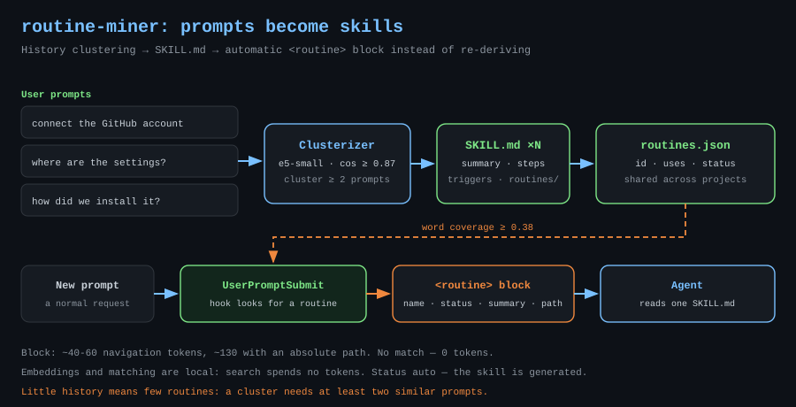
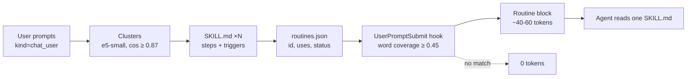

# routine-miner — skills from repeated tasks

<p align="center">
  
</p>

[Русский](../ru/routine-miner.md) · **EN**

Package page: [`plugins/routine-miner`](../../plugins/routine-miner) · Repository overview: [`README.md`](../../README.md)

## Why

You have explained this before. More than once. How to connect a GitHub account,
how to cut a release, where the project settings live — every new chat starts with
the same rediscovery, and the agent re-derives the same steps. 🧠

The miner reads your prompt history, clusters similar wording, turns the cluster
into a routine and writes a skill. On a similar prompt the hook injects a
`<routine>` block with the skill path: the agent reads one file instead of
starting from scratch.

## How it works



1. ctxdb indexes your prompt texts across all projects. The miner takes up to 400
   recent ones, de-duplicates them and embeds them with `multilingual-e5-small`
   (384d, q8, CPU).
2. Cosine **≥ 0.87** means the same wording; a cluster of **2** prompts becomes a
   routine. It gets a `SKILL.md`, a `routines.json` entry and a `kind=routine`
   chunk in the vector index.
3. On a new prompt the hook matches a routine by fuzzy word coverage; the
   threshold is **0.45**.

## Architecture

| Layer | Location | Role |
|---|---|---|
| Miner | `ctxdb\src\routines.mjs` | clustering, skill and registry writes |
| Registry | `ctxdb\routines\routines.json` | `id`, `name`, `triggers`, `uses`, `status`, `steps` |
| Skills | `ctxdb\routines\<id>\SKILL.md` | checklist, samples in `samples.json` |
| Injection | `ctxdb\hooks\user-prompt.mjs` | matching and the `<routine>` block |
| Auto-run | `ctxd` daemon | on start, at most once a day |

## What goes into a skill

- **Summary** — the first wording of the cluster, capped at 160 characters.
- **How it was usually done** — up to three short agent answers from the same
  tasks; real steps from past sessions, not a retelling.
- **Triggers and rules** — frequent meaningful words, one exact phrase and the
  "this task is repetitive" condition. When details are scarce the skill says so
  instead of inventing a step. ⚠️

## Tokens

| What | Cost |
|---|---|
| Embeddings and matching | 0 tokens, fully local |
| `<routine>` block | ~40-60 tokens of navigation, ~130 with an absolute path |
| Full `SKILL.md` | ~250-350 tokens, on demand only |
| No match | 0 tokens |

The saving is not the tiny block itself: instead of re-deriving the pattern, the
agent opens a ready checklist. ⚡

## Commands

| Command | What it does |
|---|---|
| `/routine-miner` | status: routines, repeats, top list |
| `/routine-miner scan` | run the miner and summarise the result |
| `/routine-miner test "text"` | which routine matched and its score |
| `/routine-miner open <name>` | print the routine's `SKILL.md` |
| `/routine-miner forget <id>` | delete a routine and its vector |

Under the hood: `node "...\ctxdb\src\cli.mjs" routines <status|scan|test|forget>`.

## A real case

Four times in two days a task started the same way: "connect the GitHub account".
Four times the agent rediscovered that `gh` was not installed and how to verify
the login. The miner packed it into the routine
`github-plugin-github-zcode-plugins-offic` (`uses: 4`), and on the fifth prompt
the hook injected this excerpt from `routines.json` instead of a long
investigation:

```json
{
  "id": "ba450cee50",
  "name": "github-plugin-github-zcode-plugins-offic",
  "triggers": ["[@github](plugin://github@zcode-plugins-official) подключим аккаунт", "github", "zcode"],
  "uses": 4,
  "status": "auto",
  "skillPath": "routines\\ba450cee50\\SKILL.md"
}
```

The prompt received this block (the miner's templates are Russian):

```
<routine name="github-plugin-github-zcode-plugins-offic" status="auto" uses="4" score="0.51">
Типовое задание — не разбирай с нуля. Суть: подключим аккаунт GitHub
Чек-лист и подробности: открой файл скилла "...\routines\ba450cee50\SKILL.md" и следуй ему.
Ты уже делал это 4 раз. Скилл сгенерирован автоматически, при расхождении с реальностью — уточни у пользователя.
</routine>
```

`score 0.51` was measured on "подключим аккаунт github в zcode": above the 0.45
threshold, but not an exact match, and the agent knows that.

## Management

- `status: auto` means the skill was generated; `approved` means you reviewed it,
  and the miner keeps that status on updates.
- "Forget" removes the registry entry and its vector chunk; chat history and the
  `SKILL.md` file stay on disk.
- The miner only works inside `ctxdb\routines` and never overwrites hand-written
  skills.
- A re-scan refreshes `uses`, `steps` and triggers without resetting the status.

## Limitations

- Little history means few routines: a cluster needs at least two similar
  prompts.
- Stemming is naive: a shared four-character root, so short words can produce
  false matches. The 0.45 threshold cuts most of the noise, not all of it.
- Steps come from short agent answers, not from the full log.
- The miner does not replace complex hand-written skills with checks and branches.
- Windows only: paths, CLI and hooks target this installation. ✅

## License

[MIT](../../LICENSE) © 2026 rukazax
