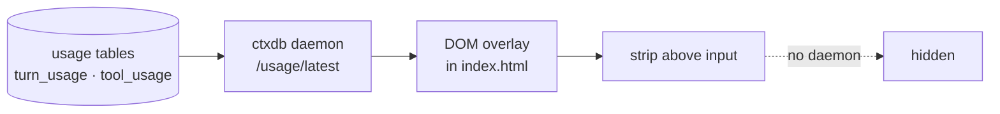

# zcode-counters · Token counters

📊 **Counters on the same line as the "Working" spinner:** to the right of it you get
`⏱ 26 ходов · ⧉ 558 шагов · ⚡ 87 ток/с · ▤ 105.9M ток · ◔ 49.8% кэш`, using the
spinner's own font and size, with labels and animated icons. Turns, steps and the total
follow **the current session/task**; speed and cache are **summed across all sessions**.
Refreshed live: 350 ms while a turn is running, 1 s when idle.
No session folder/name is shown.


## Why

ZCode shows no token numbers near the input, though they are already stored —
`turn_usage` (per turn) and `tool_usage` (per tool call) inside the chat database.
This plugin puts those numbers where you look while working.

## How it works



- the patch is small: a `<script>` inserted into `out/renderer/index.html` inside `app.asar`;
- the overlay finds the leaf element with "Working"/«Работает» text and inserts itself **right after it**,
  copying the computed font, size and colour — so the line looks native;
- icons are animated: opacity pulse on all of them, rotation on the cache one (`◔`);
- React re-renders "Working" constantly — a `MutationObserver` keeps the insertion alive;
- no React surgery; no daemon → the line stays hidden;
- co-exists with the russifier: their patches do not intersect;
- SHA-256 of changed files recalculated so Electron accepts the archive;
- the original is kept in `%LOCALAPPDATA%\ZCodeCounters\app.asar.backup`.

## What the strip shows

| Metric | Source | Formula |
|---|---|---|
| Turns | `turn_usage`, **current session** | `count(*)` |
| Steps | `tool_usage`, **current session** | `count(*)` |
| Σ tokens | **current session** turns | `sum(computed_total_tokens)` |
| Tokens/s | **all sessions** | freshest turn: `output_tokens / (completed_at − first_token_at)` |
| Cache % | **all sessions** | `sum(cache_read) / (sum(cache_read) + sum(input))` |
| “Live” | any turn with `status='running'` | 350 ms polling, faster icon animation |

The split is deliberate: **task volume** (turns, steps, total) follows the current
session/task, while **channel quality** (speed and cache hit) is measured across the whole
installation — it is a provider/prefix property, not a chat one.
“Current” means the session with the freshest activity (`session.time_updated`); while you
type in this chat, ZCode keeps updating exactly that session. The unfinished turn is counted
too. For debugging you can ask for a specific session: `/usage/latest?session=<id>`.

## Install

```powershell
powershell -NoProfile -ExecutionPolicy Bypass -File plugins\zcode-counters\assets\apply.ps1
powershell -NoProfile -ExecutionPolicy Bypass -File plugins\zcode-counters\assets\uninstall.ps1
```

Quit ZCode (tray → Quit) and start it again — the strip appears above the input.

## Limits

- Windows only; install paths `C:\Program Files\ZCode` or `%LOCALAPPDATA%\Programs\ZCode`;
- shows the active session only — other task histories are not summed;
- after every ZCode update you have to apply it again;
- if the bundle layout changes, the patcher fails with a clear message and writes nothing.

## License

[MIT](../../LICENSE) (c) 2026 rukazax
