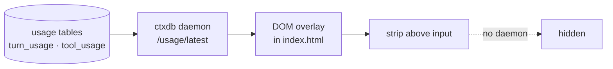

# zcode-counters · Token counters

📊 **A strip above the ZCode input field:** `21 хода · 459 steps · 29 ток/с · Σ token · кэш`
— DeepSeek-Harness-style counters, refreshed ~once a second.


## Why

ZCode shows no token numbers near the input, though they are already stored —
`turn_usage` (per turn) and `tool_usage` (per tool call) inside the chat database.
This plugin puts those numbers where you look while working.

## How it works



- the patch is small: a `<script>` inserted into `out/renderer/index.html` inside `app.asar`;
- no React surgery — the overlay lives on its own; no daemon → silently hidden;
- co-exists with the russifier: their patches do not intersect;
- SHA-256 of changed files recalculated so Electron accepts the archive;
- the original is kept in `%LOCALAPPDATA%\ZCodeCounters\app.asar.backup`.

## What the strip shows

| Metric | Source | Formula |
|---|---|---|
| Turns | `turn_usage` | completed turns of the active session |
| Steps | `tool_usage` | tool calls in the session |
| Tokens/s | last turn | `output_tokens / (completed_at − first_token_at)` |
| Σ tokens | session turns | `computed_total_tokens` |
| Cache % | session turns | `cache_read / (cache_read + input)` |

## Install

```powershell
powershell -NoProfile -ExecutionPolicy Bypass -File plugins\zcode-counters\assets\apply.ps1
powershell -NoProfile -ExecutionPolicy Bypass -File plugins\zcode-counters\assets\uninstall.ps1
```

Quit ZCode (tray → Quit) and start it again — the strip appears above the input.

## Limits

- Windows only; install paths `C:\Program Files\ZCode` or `%LOCALAPPDATA%\Programs\ZCode`;
- shows the active session only — other task histories are not summed;
- after every ZCode update you have to apply it again;
- if the bundle layout changes, the patcher fails with a clear message and writes nothing.

## License

[MIT](../../LICENSE) (c) 2026 rukazax
