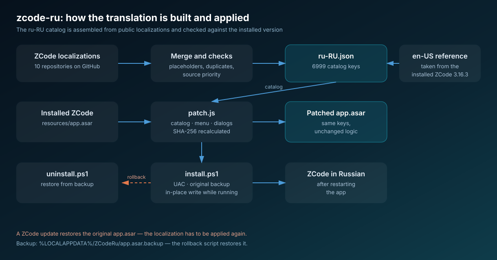
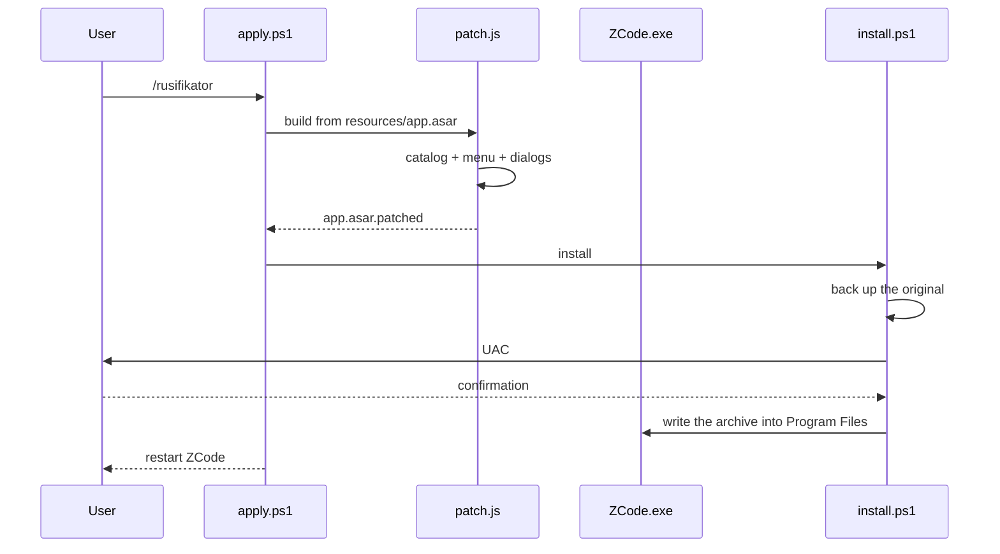

# zcode-ru — Russian UI for ZCode

<p align="center">
  
</p>

[Русский](../ru/zcode-ru.md) · **EN**

Package page: [`plugins/zcode-ru`](../../plugins/zcode-ru) · Repository overview: [`README.md`](../../README.md) ·
Publishing rules: [`AGENTS.md`](../../AGENTS.md)

## Purpose

A ZCode Desktop plugin that turns the app interface Russian: the string catalog, the native menu, the
update and about dialogs, automation templates. The plugin does not change ZCode behaviour — it only
replaces strings, so it does not affect sessions, history or settings.

ZCode ships with two locales, `zh-CN` and `en-US`, and the locale type is closed in code: a third
language cannot be added the regular way. So the translation is written into the values of the English
catalog while the keys stay untouched.

## Contents

| Layer | File | Role |
|---|---|---|
| Manifest | `.zcode-plugin/plugin.json` | name `zcode-ru`, components `skills`, `commands`, `hooks` |
| Data | `assets/translations/ru-RU.json` | `key → Russian text`, 6999 strings |
| Build | `assets/patch.js` | locates the catalog in the bundle, injects the translation, recalculates SHA-256 |
| Install | `assets/install.ps1` | backs up the original, raises UAC, writes the archive |
| Orchestration | `assets/apply.ps1` | build and install in one command |
| Rollback | `assets/uninstall.ps1` | restores `app.asar` from the backup |
| Diagnostics | `assets/check.ps1` | path, version, backup, interface language — read-only |
| Hook | `assets/hook-check.ps1` | silent check at session start after an update |
| Skill | `skills/zcode-ru/SKILL.md` | instructions for the agent: when to run what |
| Command | `commands/rusifikator.md` | `/rusifikator` with `статус` and `откат` modes |

Translation size: **6999 keys**, **6818** of them with coherent Russian text. The rest are product names
(`Discord`, `Telegram`, `Feishu`) and format strings (`{count} files`) that stay as they are in a Russian
interface.

## What changes inside the bundle

| File in `app.asar` | Content | Coverage |
|---|---|---|
| `out/renderer/assets/IntlProvider-*.js` | interface catalog | 6994 catalog keys + 5 in the shared override object |
| `out/main/chunk-*.js` | native menu | 23 of 50 items, the rest are brands |
| `out/main/index.js` | update dialogs, about box | 32 of 32 templates |
| `out/renderer/assets/styles-*.js` | automation templates, server popups | a known set of wordings |

Changed files are appended to the end of the archive and their SHA-256 in the header is recalculated —
otherwise Electron refuses to read the file. Unchanged records keep their offsets, so a running ZCode
instance keeps working until it is restarted.

## How it works



## Installation

From the ZCode chat:

```
/rusifikator
```

Or directly:

```powershell
powershell -NoProfile -ExecutionPolicy Bypass -File assets\apply.ps1
```

The script looks for ZCode in `C:\Program Files\ZCode` and `%LOCALAPPDATA%\Programs\ZCode`, builds the
patched archive into `%LOCALAPPDATA%\ZCodeRu\app.asar.patched`, keeps the original in
`%LOCALAPPDATA%\ZCodeRu\app.asar.backup` and writes the result. If ZCode is running, the file is written
in place — that is the supported path, and a restart is required anyway.

After installation the app has to be closed completely (tray → Quit) and started again.

## Check and rollback

```powershell
powershell -NoProfile -ExecutionPolicy Bypass -File assets\check.ps1
powershell -NoProfile -ExecutionPolicy Bypass -File assets\uninstall.ps1
```

`check.ps1` needs no administrator rights and changes nothing: it prints the install path, the app
version, whether a backup exists, the interface language and the amount of Cyrillic in the catalog.

## Limitations

- Windows only, with the standard ZCode install directories.
- A ZCode update restores the original `app.asar`; the localization has to be applied again — the
  SessionStart hook reminds about that.
- Strings coming from the API are translated only for a known set of wordings.
- If the bundle layout changes, `patch.js` fails with a clear message and writes no file, so the
  installation does not happen.

## Verified

- A build from the stock backup matched the installed archive byte for byte (SHA-256 `b2183d64…`).
- The changed chunks pass `node --check`; the archive header is valid JSON with consistent offsets and
  hashes.
- `check.ps1` on a live installation confirms a Russian interface, version 3.16.3 and an existing backup.
- The install and rollback commands were exercised on a real ZCode 3.16.3 installation.
