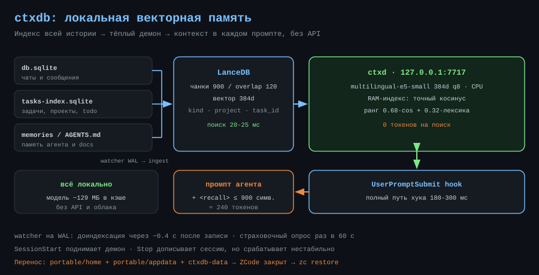
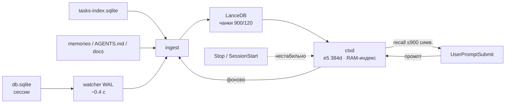

# ctxdb-setup — локальная векторная память ZCode

<p align="center">
  
</p>

**RU** · [English](../en/ctxdb-setup.md)

Страница пакета: [`plugins/ctxdb-setup`](../../plugins/ctxdb-setup) · Обзор репозитория: [`README.md`](../../README.md)

## Что это

Сквозной индекс всех чатов, задач, памяти агента и документов по всем проектам.
Релевантный контекст подставляется в каждый промпт автоматически, с явным
разделением по проектам и задачам. Всё локально: LanceDB + `multilingual-e5-small`;
при работе в сеть уходит только разовая загрузка весов модели. 📦

| Метрика | Значение |
|---|---|
| Поиск в демоне | 20-25 мс |
| Полный путь хука | 180-300 мс |
| Токенов на поиск | 0 |
| Вставка в промпт | ≤ 900 символов ≈ 240 токенов |
| Модель в кэше | ~129 МБ |

## Стек

| Компонент | Выбор | Почему |
|---|---|---|
| Векторная БД | LanceDB (Rust, embedded) + RAM-индекс | без Docker и сервера, IVF-PQ, точный косинус в памяти |
| Эмбеддинги | `Xenova/multilingual-e5-small` (384d, q8, ONNX CPU) | мультиязычная, ~8 мс/запрос |
| Ранжирование | 0.68·cos + 0.32·лексика + бонус проекта | вектор ловит смысл, лексика — имена и числа |
| Транспорт | HTTP 127.0.0.1:7717, `node:http` в хуке | без лишних зависимостей |
## Архитектура



Демон держит модель и векторы в памяти: загрузка модели в одноразовом процессе
стоила бы ~2.5 с на каждый промпт, а тёплый демон отвечает за 20-25 мс.

## Установка по шагам

1. **Пререквизиты.** Windows 10/11 x64, Node.js LTS, Visual C++ Redistributable
   2015-2022 x64. Без VCRedist native LanceDB не грузится: `dlopen` падает.

   ```powershell
   winget install --id OpenJS.NodeJS.LTS --accept-source-agreements --accept-package-agreements
   winget install --id Microsoft.VCRedist.2015+.x64 --accept-source-agreements --accept-package-agreements
   ```

2. **Каталог ctxdb.** Исходники не входят в репозиторий плагинов: возьми
   `C:\Users\er-ka\Documents\z-code\ctxdb` из своей рабочей копии или из архива
   переезда.

3. **Зависимости.** `npm install` из каталога ctxdb. Install scripts должны быть
   разрешены: `onnxruntime-node`, `sharp` и `protobufjs` докачивают бинарники.
   Проверка: `node_modules\@lancedb\lancedb-win32-x64-msvc\lancedb.win32-x64-msvc.node`,
   `node_modules\onnxruntime-node\bin\napi-v6\win32\x64\onnxruntime.dll`.

4. **Диагностика.** `node src\cli.mjs doctor` — `lancedb ok`, `демон ok`,
   `хуки в конфиге ok`.

5. **Демон и индекс.** `daemon start`, затем `ingest` (первый прогон — минуты,
   дальше инкрементально) и `stats`.

6. **Хуки.** `install-hooks` прописывает `SessionStart`, `UserPromptSubmit`,
   `Stop` в `%USERPROFILE%\.zcode\cli\config.json` и делает бэкап
   `config.json.ctxdb-backup`. Нужен новый чат или перезапуск ZCode.

## Разделение по проектам

Каждый фрагмент несёт `project` (ключ рабочего каталога), `project_path`,
`task_id`/`task_title`, `kind` (`chat_user`, `chat_assistant`, `memory`, `task`,
`todo`, `doc`, `instruction`, `routine`) и `ts`. По умолчанию `scope: auto`:
поиск идёт по всем проектам, свои фрагменты получают бонус, а вывод сгруппирован
как «текущий» / «другой проект — переносимый опыт». Жёстко ограничить:
`search "..." --project <key> --scope project`.

## Перенос установки

На старой машине:

```powershell
cd C:\Users\er-ka\Documents\z-code
.\zc.cmd backup --with-projects
```

Снимок `portable\` содержит два дерева — `home\` (копия `~/.zcode`: чаты, конфиг,
память, плагины, workspace) и `appdata\.zcode\` (настройки, боты, задачи,
credentials) — плюс `ctxdb-data\`, `secrets\gh\`, `projects\` и `manifest.json`.
Дальше скопируй всю папку `Documents\z-code` на новую машину.

На новой машине ZCode должен быть **закрыт**:

```powershell
.\zc.cmd restore --dry-run
.\zc.cmd restore
```

`restore` возвращает оба дерева, перезаписывает абсолютные пути (хуки,
`installPath` плагинов, `dataBaseDir`), показывает проекты и складывает старые
файлы в `portable\_before-restore\`.

⚠️ Снимок по умолчанию **содержит секреты** — `credentials.json` и токен `gh`.
Исключить: `backup --no-credentials`. Папку `portable\` храни как профиль
пользователя; при передаче через облако или флешку — шифруй.

## Диагностика

- Лог демона: `ctxdb\data\ctxd.log`, отладка хуков: `data\hook-debug.log`.
- Актуальность: watcher на WAL `db.sqlite` и `tasks-index.sqlite` даёт
  доиндексацию через ~0.4 с после записи; плюс страховочный опрос раз в 60 с.
- `Stop`-хук в этой сборке срабатывает нестабильно — не полагайся на него как на
  единственный триггер.
- Демон не отвечает: `daemon stop`, проверь порт 7717, `daemon start`.
- Пустой поиск: `stats` (строки) → `ingest`; при смене `dataBaseDir` в
  `setting.json` старый `v2` может быть устаревшей копией.
- Сброс базы: удалить `data\lancedb` и `data\state.json`, затем `ingest --full`.

## Ограничения

- Windows-only: пути, демон и хуки рассчитаны на Windows.
- Индексируются только текстовые части сообщений; вывод инструментов и
  `reasoning` — шум, они не попадают в индекс.
- Короткие реплики (меньше 12 символов) хук пропускает.
- Без сети первый запуск не прогреет модель.
- Перенос требует закрытого ZCode: открытое приложение держит базу чатов. ✅

## Лицензия

[MIT](../../LICENSE) © 2026 rukazax
