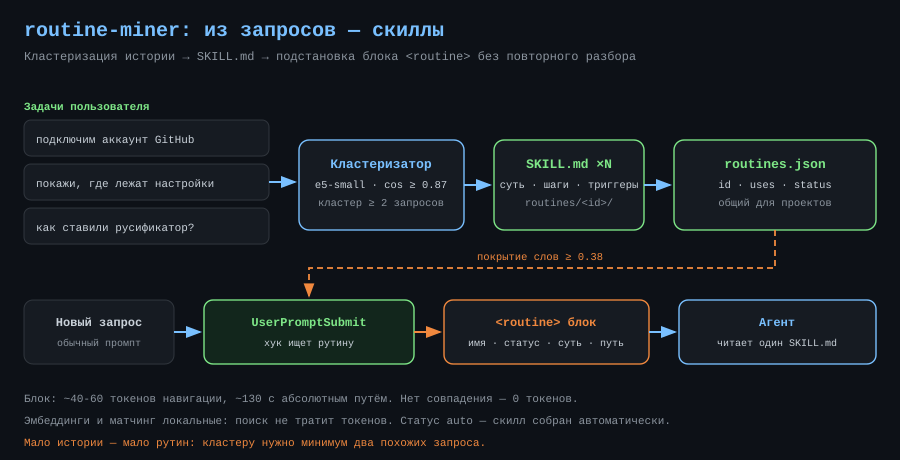
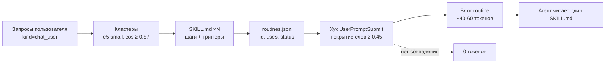

# routine-miner — скилы из повторяющихся задач

<p align="center">
  
</p>

**RU** · [English](../en/routine-miner.md)

Страница пакета: [`plugins/routine-miner`](../../plugins/routine-miner) · Обзор репозитория: [`README.md`](../../README.md)

## Зачем

Ты уже объяснял это. Не один раз. Как подключить GitHub-аккаунт, как собрать
релиз, где лежат настройки проекта — каждый новый чат начинается с повторного
разбора, и агент заново выводит те же шаги. 🧠

Майнер смотрит на историю запросов, находит похожие формулировки, сводит их в
рутину и пишет скилл. На похожий запрос хук подставляет блок `<routine>` с путём
к скиллу: агент читает один файл вместо разбора с нуля.

## Как работает



1. ctxdb индексирует тексты твоих запросов по всем проектам. Майнер берёт до 400
   последних, дедуплицирует и считает эмбеддинги `multilingual-e5-small`
   (384d, q8, CPU).
2. Косинус **≥ 0.87** — одна формулировка; кластер от **2** запросов становится
   рутиной. Для неё пишется `SKILL.md`, запись уходит в `routines.json`, сама
   рутина индексируется чанком `kind=routine`.
3. На новом промпте хук ищет рутину по нечёткому покрытию слов; порог **0.45**.

## Архитектура

| Слой | Где | Роль |
|---|---|---|
| Майнер | `ctxdb\src\routines.mjs` | кластеризация, запись скиллов и реестра |
| Реестр | `ctxdb\routines\routines.json` | `id`, `name`, `triggers`, `uses`, `status`, `steps` |
| Скиллы | `ctxdb\routines\<id>\SKILL.md` | чек-лист, образцы в `samples.json` |
| Подстановка | `ctxdb\hooks\user-prompt.mjs` | матчинг и блок `<routine>` |
| Автопрогон | демон `ctxd` | при старте и не чаще раза в сутки |

## Что попадает в скилл

- **Суть** — первая формулировка кластера, до 160 символов.
- **Как это обычно делалось** — до трёх коротких ответов агента из тех же
  задач; реальные шаги прошлых сессий, а не пересказ.
- **Триггеры и правила** — частотные значимые слова, одна точная фраза и условие
  «задача повторная». Деталей мало — стоит честная заглушка, а не выдуманный
  шаг. ⚠️

## Токены

| Что | Стоимость |
|---|---|
| Эмбеддинги и матчинг | 0 токенов, всё локально |
| Блок `<routine>` | ~40-60 токенов навигации, ~130 с абсолютным путём |
| Полный `SKILL.md` | ~250-350 токенов, только по требованию |
| Нет совпадения | 0 токенов |

Экономия не в крошечном блоке, а в том, что вместо повторного вывода паттернов
агент открывает готовый чек-лист. ⚡

## Команды

| Команда | Что делает |
|---|---|
| `/routine-miner` | статус: рутины, повторы, топ |
| `/routine-miner скан` | запустить майнер и пересказать итог |
| `/routine-miner проверить "текст"` | какая рутина сработала и score |
| `/routine-miner открыть <имя>` | показать `SKILL.md` рутины |
| `/routine-miner забыть <id>` | удалить рутину и её вектор |

Под капотом — CLI: `node "...\ctxdb\src\cli.mjs" routines <status|scan|test|forget>`.

## Пример из жизни

Четыре раза за два дня задача начиналась одинаково: «подключим аккаунт GitHub».
Четыре раза агент заново выяснял, что `gh` не установлен и как проверить вход.
Майнер собрал это в рутину `github-plugin-github-zcode-plugins-offic` (`uses: 4`),
и на пятый запрос хук подставил вместо долгого разбора выдержку из
`routines.json`:

```json
{
  "id": "ba450cee50",
  "name": "github-plugin-github-zcode-plugins-offic",
  "triggers": ["[@github](plugin://github@zcode-plugins-official) подключим аккаунт", "github", "zcode"],
  "uses": 4,
  "status": "auto",
  "skillPath": "routines\\ba450cee50\\SKILL.md"
}
```

В промпт ушёл блок:

```
<routine name="github-plugin-github-zcode-plugins-offic" status="auto" uses="4" score="0.51">
Типовое задание — не разбирай с нуля. Суть: подключим аккаунт GitHub
Чек-лист и подробности: открой файл скилла "...\routines\ba450cee50\SKILL.md" и следуй ему.
Ты уже делал это 4 раз. Скилл сгенерирован автоматически, при расхождении с реальностью — уточни у пользователя.
</routine>
```

`score 0.51` — фраза «подключим аккаунт github в zcode»: порог 0.45 пройден, но
совпадение не точное, и агент об этом знает.

## Управление

- `status: auto` — скилл собран автоматически; `approved` — проверен руками,
  майнер сохраняет статус при обновлении.
- «Забыть» удаляет запись из реестра и её векторный чанк; история чатов и
  `SKILL.md` остаются на диске.
- Майнер работает только в `ctxdb\routines` и не перезаписывает ручные скиллы.
- Повторный скан обновляет `uses`, `steps` и триггеры, но не сбрасывает статус.

## Ограничения

- Мало истории — мало рутин: кластеру нужно минимум два похожих запроса.
- Стемминг наивный: общий корень в 4 символа, короткие слова иногда дают ложные
  совпадения. Порог 0.45 режет большую часть шума, но не весь.
- Шаги берутся из коротких ответов агента, а не из полного лога.
- Майнер не заменяет ручные сложные скиллы с проверками и ветвлениями.
- Windows-only: пути, CLI и хуки рассчитаны на эту установку. ✅

## Лицензия

[MIT](../../LICENSE) © 2026 rukazax
