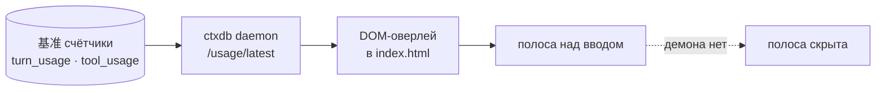

# zcode-counters · Счётчики токенов

📊 **Полоса над полем ввода ZCode:** `21 ход · 459 шагов · 29 ток/с · Σ 70.8 млн · кэш 49.9%`
— в стиле DeepSeek Harness, обновляется ~раз в секунду.


## Зачем

ZCode не показывает токены у поля ввода, а они уже посчитаны — в базе чатов
лежат `turn_usage` (по ходам) и `tool_usage` (по инструментам). Плагин выносит
эти цифры на экран, где ты глазами смотришь, во что обходится текущая задачка.

## Как работает



- патч мягкий: только `<script>`-вставка в `out/renderer/index.html` внутри `app.asar`;
- вмешательства в React нет — оверлей живёт сам по себе, демона нет → тихо молчит;
- работает вместе с русификатором: их правки не пересекаются;
- SHA-256 изменённых файлов пересчитывается — Electron примет архив;
- оригинал хранится в `%LOCALAPPDATA%\ZCodeCounters\app.asar.backup`.

## Что в полосе

| Показатель | Откуда | Формула |
|---|---|---|
| Ходы | `turn_usage` | завершённые ходы активной сессии |
| Шаги | `tool_usage` | всего вызовов инструментов в сессии |
| Ток/с | последний ход | `output_tokens / (completed_at − first_token_at)` |
| Σ токенов | ходы сессии | `computed_total_tokens` |
| Кэш % | ходы сессии | `cache_read / (cache_read + input)` |

Строка показывает живую активную сессию; если чатов открытых нет — полоса
просто не отображается.

## Установка

```powershell
powershell -NoProfile -ExecutionPolicy Bypass -File plugins\zcode-counters\assets\apply.ps1
powershell -NoProfile -ExecutionPolicy Bypass -File plugins\zcode-counters\assets\uninstall.ps1
```

После установки полностью закрой ZCode (трей → «Выйти») и запусти заново —
полоса появится над полем ввода.

## Ограничения

- только Windows; путь установки `C:\Program Files\ZCode` или `%LOCALAPPDATA%\Programs\ZCode`;
- показывает счётчики активной сессии — отдельные истории по задачам не суммируются;
- наша настройка «экономии токенов» и провайдерский prompt-cache разные вещи:
  в полосе видно кэш как есть у провайдера, а общую экономию от ctxdb смотри
  в её стороне (то aктуальный расход до и после);
- после каждого обновления ZCode установка нужна заново;
- если структура бандла поменяется, патчер выйдет с понятной ошибкой и ничего не запишет.

## Лицензия

[MIT](../../LICENSE) c 2026 rukazax
