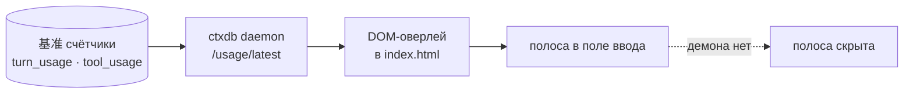

# zcode-counters · Счётчики токенов

📊 **Счётчики внутри поля ввода:** у нижнего края композера, в одну строку —
`⏱ 128 ходов · ⧉ 1024 шагов · ⚡ 34 ток/с · ▤ 436.7 млн ток · ◔ 49.6% кэш · 💳 $17.64 баланс · ⟳ 89% лимиты`.
Значения ярче подписей, цифры моноширинные, иконки анимируются только пока числа меняются.
Ходы, шаги и сумма — **по текущей сессии/задаче**, скорость и кэш — **суммарно по всем
сессиям**; обновление живое, раз в 400 мс. Папка/название сессии не показываются.


## Зачем

ZCode не показывает токены у поля ввода, а они уже посчитаны — в базе чатов
лежат `turn_usage` (по ходам) и `tool_usage` (по инструментам). Плагин выносит
эти цифры на экран, где ты глазами смотришь, во что обходится текущая задачка.

## Как работает



- патч мягкий: только `<script>`-вставка в `out/renderer/index.html` внутри `app.asar`;
- оверлей находит поле ввода (`textarea` / `contenteditable`), поднимается к рамке
  композера, резервирует 22 px снизу и прикрепляет полосу к нижнему краю — она не
  уезжает в переписку и переживает перерисовки React;
- иконки — inline-SVG размером 1em; анимация включается только когда значения
  меняются, в простое стоит;
- «Working» и его таймер не трогаются — полоса живёт ниже, внутри композера;
- баланс и «лимиты» следуют за **выбранной моделью**: провайдер берётся из
  `modelSelection` последнего запроса, а не из последней генерации;
- вмешательства в React нет; демона нет → строка тихо скрыта;
- работает вместе с русификатором: правки не пересекаются;
- SHA-256 изменённых файлов пересчитывается — Electron примет архив;
- оригинал хранится в `%LOCALAPPDATA%\ZCodeCounters\app.asar.backup`.

## Что в полосе

| Показатель | Откуда | Формула |
|---|---|---|
| Ходы | `turn_usage` **текущей сессии** | `count(*)` |
| Шаги | `tool_usage` **текущей сессии** | `count(*)` |
| Σ токенов | ходы **текущей сессии** | `sum(computed_total_tokens)` |
| Ток/с | **все сессии** | последний по времени ход: `output_tokens / (completed_at − first_token_at)` |
| Кэш % | **все сессии** | `sum(cache_read) / (sum(cache_read) + sum(input))` |
| Баланс | `balance.json`, провайдер **выбранной модели** | `providers[provider].amount` |
| Лимиты % | тот же провайдер | `100 − usedPct` (остаток; нет квоты — прочерк) |
| «Живёт» | любой ход в статусе `running` | опрос 400 мс, ускоренная анимация |

Смешанная семантика специально: **объём задачи** (ходы, шаги, сумма) — по текущей
сессии/задаче, **качество канала** (скорость и попадание в кэш) — по всей установке,
потому что это свойство провайдера и префикса, а не одного чата.
«Текущая» = сессия с самой свежей активностью (`session.time_updated`); пока ты пишешь
в этом чате, ZCode обновляет именно её. Незавершённый ход тоже учитывается.
Для отладки можно запросить конкретную сессию: `/usage/latest?session=<id>`.

Провайдер для денег и процента — из `modelSelection` последнего запроса: выбрал
GLM/Kimi под opencode — увидишь `$0.00` и остаток месячной квоты opencode, выбрал
DeepSeek — его баланс и прочерк вместо квоты. Строка `model_usage` используется
только как фолбэк, если в сообщении выбора модели нет.

## Установка

```powershell
powershell -NoProfile -ExecutionPolicy Bypass -File plugins\zcode-counters\assets\apply.ps1
powershell -NoProfile -ExecutionPolicy Bypass -File plugins\zcode-counters\assets\uninstall.ps1
```

После установки полностью закрой ZCode (трей → «Выйти») и запусти заново —
полоса появится внутри поля ввода.

## Ограничения

- только Windows; путь установки `C:\Program Files\ZCode` или `%LOCALAPPDATA%\Programs\ZCode`;
- показывает счётчики активной сессии — отдельные истории по задачам не суммируются;
- наша настройка «экономии токенов» и провайдерский prompt-cache разные вещи:
  в полосе видно кэш как есть у провайдера, а общую экономию от ctxdb смотри
  в её стороне (то aктуальный расход до и после);
- после каждого обновления ZCode установка нужна заново;
- если структура бандла поменяется, патчер выйдет с понятной ошибкой и ничего не запишет.

## Лицензия

[MIT](../../LICENSE) c 2026 rukazax
