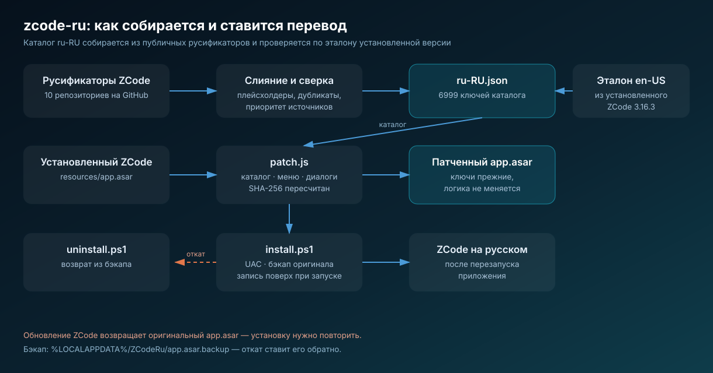
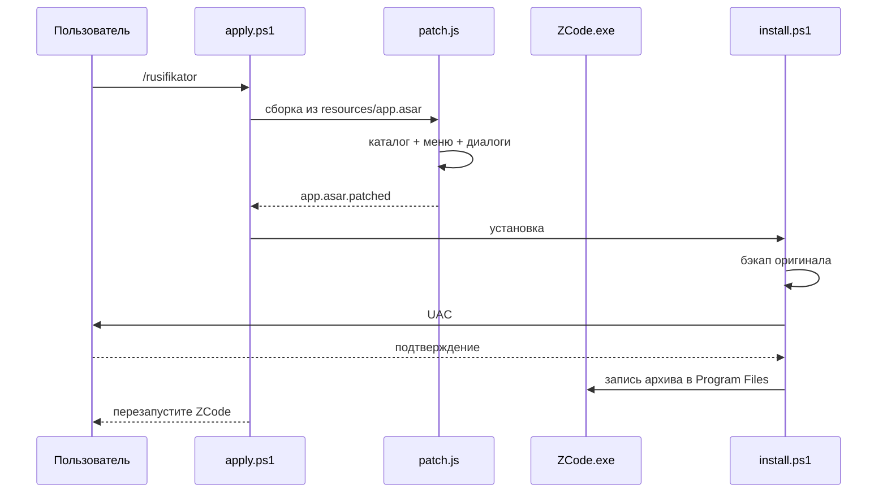

# zcode-ru — русский интерфейс ZCode

<p align="center">
  
</p>

**RU** · [English](../en/zcode-ru.md)

Страница пакета: [`plugins/zcode-ru`](../../plugins/zcode-ru) · Обзор репозитория: [`README.md`](../../README.md) ·
Правила публикации: [`AGENTS.md`](../../AGENTS.md)

## Назначение

Плагин ZCode Desktop, который делает интерфейс приложения русским: каталог строк, нативное меню,
диалоги обновления и «О программе», шаблоны автоматизаций. Плагин не меняет поведение ZCode — он
только подменяет строки, поэтому не влияет на сессии, историю и настройки.

ZCode поставляется с двумя локалями, `zh-CN` и `en-US`, и тип локали закрыт в коде: добавить третий
язык штатным способом нельзя. Поэтому перевод записывается в значения английского каталога, а ключи
остаются прежними.

## Что внутри

| Слой | Файл | Роль |
|---|---|---|
| Манифест | `.zcode-plugin/plugin.json` | имя `zcode-ru`, компоненты `skills`, `commands`, `hooks` |
| Данные | `assets/translations/ru-RU.json` | `ключ → русский текст`, 6999 строк |
| Сборка | `assets/patch.js` | находит каталог в бандле, подставляет перевод, пересчитывает SHA-256 |
| Установка | `assets/install.ps1` | бэкап оригинала, запрос UAC, запись архива |
| Оркестрация | `assets/apply.ps1` | сборка и установка одной командой |
| Откат | `assets/uninstall.ps1` | возврат `app.asar` из бэкапа |
| Диагностика | `assets/check.ps1` | путь, версия, бэкап, язык интерфейса — только чтение |
| Хук | `assets/hook-check.ps1` | тихая проверка на старте сессии после обновления |
| Скилл | `skills/zcode-ru/SKILL.md` | инструкции агенту: когда и что запускать |
| Команда | `commands/rusifikator.md` | `/rusifikator` с режимами `статус` и `откат` |

Объём перевода: **6999 ключей**, из них **6818** со связным русским текстом. Остальное — названия
продуктов (`Discord`, `Telegram`, `Feishu`) и строки-форматы (`{count} файлов`), которые в русском
интерфейсе остаются как есть.

## Что именно меняется в бандле

| Файл в `app.asar` | Содержимое | Покрытие |
|---|---|---|
| `out/renderer/assets/IntlProvider-*.js` | каталог интерфейса | 6994 ключа в каталоге + 5 в общем объекте-оверрайде |
| `out/main/chunk-*.js` | нативное меню | 23 из 50 пунктов, остальные — бренды |
| `out/main/index.js` | диалоги обновления, «О программе» | 32 из 32 заготовок |
| `out/renderer/assets/styles-*.js` | шаблоны автоматизаций, серверные попапы | известный набор формулировок |

Изменённые файлы дописываются в конец архива, их SHA-256 в заголовке пересчитывается — иначе Electron
откажется читать файл. Неизменённые записи сохраняют смещения, поэтому запущенный ZCode продолжает
работать до перезапуска.

## Схема работы



## Установка

Из чата ZCode:

```
/rusifikator
```

Или напрямую:

```powershell
powershell -NoProfile -ExecutionPolicy Bypass -File assets\apply.ps1
```

Скрипт ищет ZCode в `C:\Program Files\ZCode` и `%LOCALAPPDATA%\Programs\ZCode`, собирает патченный
архив в `%LOCALAPPDATA%\ZCodeRu\app.asar.patched`, сохраняет оригинал в
`%LOCALAPPDATA%\ZCodeRu\app.asar.backup` и записывает результат. Если ZCode запущен, файл пишется
поверх существующего — это штатный путь, перезапуск всё равно обязателен.

После установки приложение нужно закрыть полностью (трей → «Выйти») и открыть заново.

## Проверка и откат

```powershell
powershell -NoProfile -ExecutionPolicy Bypass -File assets\check.ps1
powershell -NoProfile -ExecutionPolicy Bypass -File assets\uninstall.ps1
```

`check.ps1` не требует прав администратора и не меняет файлы: печатает путь установки, версию
приложения, наличие бэкапа, язык интерфейса и объём кириллицы в каталоге.

## Ограничения

- Windows: поддержаны стандартные каталоги установки ZCode.
- Обновление ZCode возвращает оригинальный `app.asar`; установку нужно повторить — об этом
  напоминает SessionStart-хук.
- Строки, которые приходят с API, переводятся только для известного набора формулировок.
- При изменении структуры бандла `patch.js` завершается ошибкой с понятным сообщением и не пишет
  файл — установка в этом случае не выполняется.

## Что проверено

- Сборка из стокового бэкапа побайтно совпала с установленным архивом (SHA-256 `b2183d64…`).
- Изменённые чанки проходят `node --check`; заголовок архива — валидный JSON, смещения и хэши
  согласованы.
- `check.ps1` на живой установке подтверждает русский интерфейс, версию 3.16.3 и наличие бэкапа.
- Команды установки и отката проверены на реальной установке ZCode 3.16.3.
