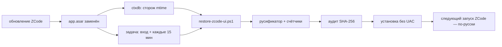

# tools · Автовосстановление интерфейса ZCode

⚡ ZCode при обновлении заменяет `app.asar` — вместе с ним бесследно исчезают
русификатор и полоса счётчиков. Эти скрипты возвращают всё сами: без ручных
команд, без UAC и без «а я думал, оно само».

## Что внутри

| Файл | Зачем |
|---|---|
| `install-zcode-ui-task.ps1` | один раз регистрирует задачу Windows `ZCodeUiRestore` |
| `restore-zcode-ui.ps1` | собирает русификатор + счётчики, проверяет SHA-256, ставит архив |
| `asar-check.cjs` | быстрая проверка: версия ZCode и наличие патчей |
| `audit-asar.cjs` | сверяет SHA-256 **каждого** файла архива с заголовком |

## Установка (один раз)

```powershell
powershell -NoProfile -ExecutionPolicy Bypass -File tools\install-zcode-ui-task.ps1
```

Скрипт запросит UAC, зарегистрирует задачу и сразу её прогонит. Дальше — тишина:
задача запускается **при входе в систему** (через 30 секунд) и **каждые 15 минут**,
с правами администратора, поэтому UAC больше не появляется.

## Как это работает



- **ctxdb** каждую минуту смотрит на `mtime` файла `app.asar`; изменился — сразу
  запускает задачу. Это ловит обновление, даже если оно случилось при работающем ZCode.
- **Задача** — страховка: вход в систему и повтор каждые 15 минут.
- **Скрипт** сначала проверяет патчи. Если оба на месте — выходит за ~0,3 с и ничего
  не трогает. Если нет — ждёт, пока обновлятор допишет архив, собирает новый
  (русификатор → счётчики), прогоняет аудит всех файлов и ставит.
- Патчи применяются **к следующему запуску** ZCode: текущее окно держит старый
  `index.html` в памяти, перезагрузка окна не помогает из-за кэша asar.

## Ручные команды

```powershell
# восстановить прямо сейчас (UAC)
powershell -NoProfile -ExecutionPolicy Bypass -File tools\restore-zcode-ui.ps1

# только собрать архив, ничего не устанавливать
... -BuildOnly

# пересобрать, даже если патчи уже стоят
... -Force
```

Лог: `%LOCALAPPDATA%\ZCodeUiRestore\zcode-ui-restore.log` (пишутся только
восстановления и ошибки, «всё на месте» не спамит).

## Ограничения

- Windows; пути установки `C:\Program Files\ZCode` или `%LOCALAPPDATA%\Programs\ZCode`;
- нужен Node.js в `PATH` (для `asar-check` и `audit-asar`);
- задача работает, пока пользователь вошёл в систему (Interactive, Highest);
- откат — `plugins\zcode-counters\assets\uninstall.ps1` (вернёт стоковый `app.asar`);
- если структура бандла ZCode сильно изменится, патчеры выйдут с понятной ошибкой
  и ничего не запишут — установка не сломается.

## English

`tools/` contains a self-healing setup for the ZCode UI. ZCode updates replace
`app.asar`, wiping the Russian localization and the token-counter strip.
`install-zcode-ui-task.ps1` registers the `ZCodeUiRestore` scheduled task (at logon
and every 15 minutes, highest privileges, no UAC prompts); `restore-zcode-ui.ps1`
rebuilds both patches, verifies every file hash and installs the archive. The ctxdb
daemon watches `app.asar` mtime and triggers the task as soon as ZCode updates.
Patches take effect on the next ZCode launch. Log:
`%LOCALAPPDATA%\ZCodeUiRestore\zcode-ui-restore.log`.
